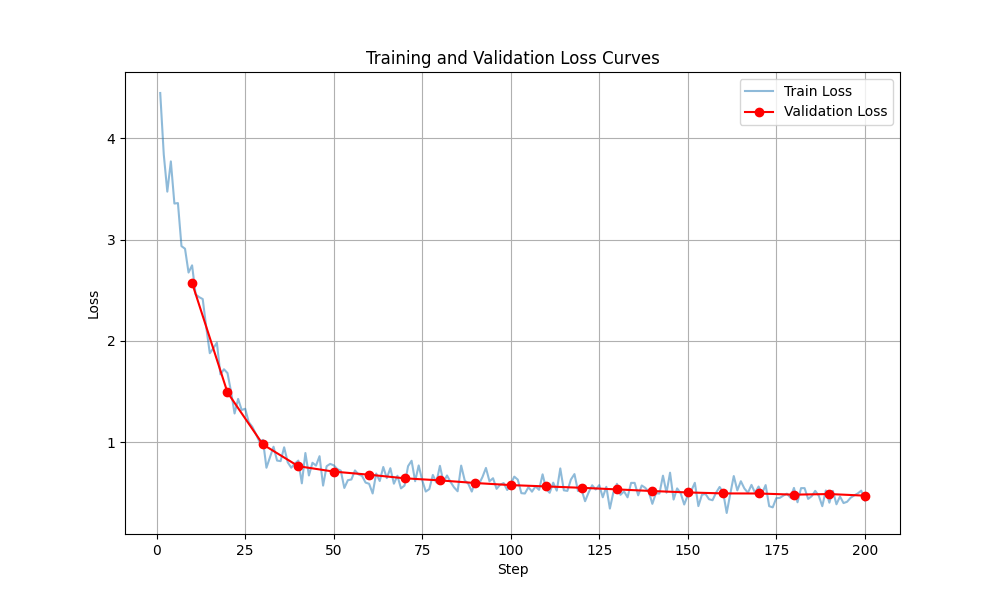

# Hybrid RAG & QLoRA Fine-Tuning for Customer Support

An end-to-end customer support generation system built on **Qwen2.5-1.5B-Instruct** that combines **ChromaDB semantic retrieval** over corporate Standard Operating Procedures (SOPs) with a **QLoRA fine-tuned JSON intent router** to ground responses and reduce policy hallucinations.

---

## System Evolution & Architecture

To isolate and measure the independent contributions of retrieval and parameter-efficient fine-tuning, three progressively enhanced architectures were evaluated on an identical, leak-free held-out test split (50 queries across 24 customer support intents):

1. **Baseline Model:** Pre-trained `Qwen/Qwen2.5-1.5B-Instruct` (4-bit NF4) evaluated directly with deterministic decoding (`do_sample=False`).
2. **Solution V1 (Naive RAG):** Embeds chunked corporate SOP Markdown documents using `all-MiniLM-L6-v2` into a **ChromaDB** vector store and augments prompts with top-3 retrieved policy passages.
3. **Solution V2 (Hybrid RAG):** Fine-tunes `Qwen2.5-1.5B-Instruct` with **QLoRA** (rank 16, custom AdamW loop, ChatML formatting, `-100` label masking, and validation-loss early stopping) to extract structured JSON (`{"intent": "...", "category": "..."}`) from noisy queries, mapping the predicted intent into targeted SOP retrieval queries.

    Customer Query (Noisy / Adversarial)
           │
           ▼
    [QLoRA Fine-Tuned Intent Router] ──► Strict JSON {"intent": "...", "category": "..."}
           │
           ▼
    [ChromaDB Semantic Retriever]    ──► Top-3 Corporate SOP Policy Lookup (MiniLM-L6-v2)
           │
           ▼
    [Grounded Response Generator]    ──► SOP-Compliant Customer Support Response

---

## Key Evaluation Results

All three systems were benchmarked on the same 50 held-out test queries against SOP-grounded reference responses:

| Metric | Baseline LLM | Solution V1 (Naive RAG) | Solution V2 (Hybrid RAG) |
| :--- | :---: | :---: | :---: |
| **Router JSON Format Adherence** | N/A | N/A | **100.0%** (50/50) |
| **Router Exact-Match Intent Accuracy** | N/A | N/A | **28.0%** (14/50) |
| **ROUGE-1 (vs. Baseline / V1)** | Baseline | **+32.5%** | -48.9% vs. V1 |
| **ROUGE-L Score** | 0.275 | **0.378 (+37.4%)** | 0.148 (-60.8% vs. V1) |
| **BLEU Score** | 0.060 | **0.172 (+187.6%)** | 0.025 (-85.5% vs. V1) |
| **Avg. Response Length** | — | **33 words** | 99 words |
| **Mid-Sentence Truncation Rate** | — | **0.0%** (0/50) | 74.0% (37/50) |
| **Relative Inference Latency** | 1.0x | **1.9x** | 5.1x (2.7x vs. V1) |

*(Full per-sample outputs, paired Wilcoxon significance tests, and ablation logs are available in `outputs/Comparative_Results_Summary.csv`, `outputs/Comparative_Results_Full.csv`, and `reports/Comparative_Analysis_Report.pdf`.)*

---

## Key Findings & Error Analysis

* **Retrieval Delivered Significant Gains (Baseline → Naive RAG):** Grounding generation with top-3 ChromaDB policy chunks boosted ROUGE-L by **+37.4%** (`0.275 → 0.378`) and BLEU by **+187.6%** (`0.060 → 0.172`), with statistically significant improvements across all similarity metrics (paired Wilcoxon $p < 0.01$) and zero truncated responses.
* **Unconstrained Router Vocabulary Degraded Downstream Retrieval (Naive RAG → Hybrid RAG):** While the QLoRA router achieved **100% syntactically valid JSON formatting**, 66% (33/50) of predicted intent labels fell outside the target dataset vocabulary, producing weaker retrieval strings and verbose outputs (99 words avg., 37/50 truncated).
* **Production Recommendation & Next Steps:** Deploy **Solution V1 (Naive RAG)** for immediate production reliability, and upgrade **Solution V2** in the next iteration using constrained JSON schema/vocabulary decoding, expanded multi-intent training coverage, and explicit `max_new_tokens` / stop-sequence controls.

### QLoRA Training & Validation Convergence

---

## Repository Structure

    Hybrid-RAG-Fine-Tuning-for-Customer-Support/
    ├── corporate_policies/          # 5 corporate SOP Markdown files (refund, shipping, password, tech support, escalation)
    ├── notebooks/                   # End-to-end Jupyter notebooks (01_EDA through 07_Solution_V2_Evaluation)
    ├── outputs/
    │   ├── lora_training_artifacts/ # Training logs, loss curves, and reproducibility metadata
    │   └── *.csv / *.json           # Held-out test split and benchmark tables across Baseline, V1, and V2
    ├── reports/                     # Project Proposal & Methodology PDF and Final Comparative Analysis PDF
    ├── .gitignore
    ├── requirements.txt
    └── README.md

---

## Tech Stack

* **LLM & Parameter-Efficient Fine-Tuning:** PyTorch, Hugging Face `transformers`, `peft` (QLoRA), `bitsandbytes`, `accelerate`
* **Retrieval & Embeddings:** ChromaDB, `sentence-transformers` (`all-MiniLM-L6-v2`), LangChain
* **Data Processing & Evaluation:** `pandas`, `numpy`, `scikit-learn`, `rouge-score`, `nltk`, `matplotlib`, `seaborn`

---

## Getting Started

    # 1. Clone the repository
    git clone https://github.com/nanditaverma25/Hybrid-RAG-Fine-Tuning-for-Customer-Support.git
    cd Hybrid-RAG-Fine-Tuning-for-Customer-Support

    # 2. Install dependencies
    pip install -r requirements.txt

    # 3. Run notebooks sequentially inside notebooks/ (01 through 07)
